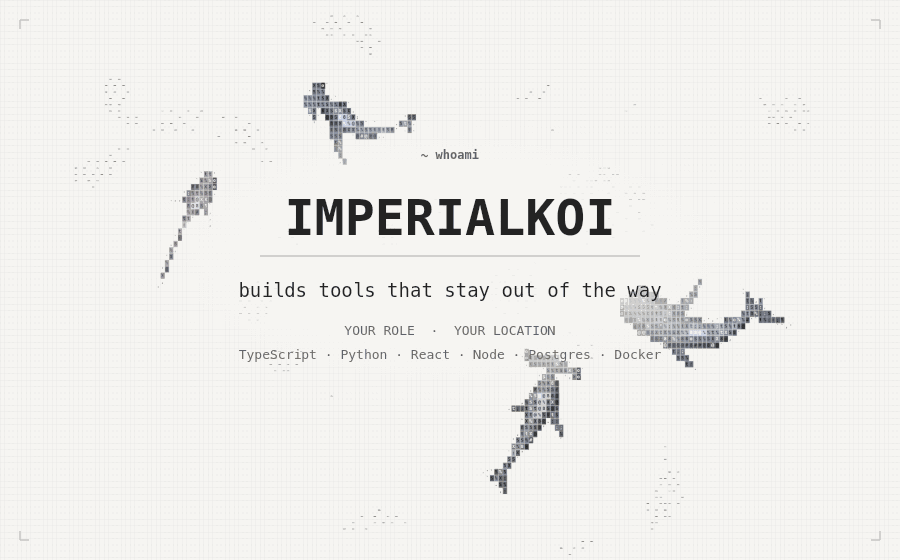

<!--
  GitHub profile README · github.com/ImperialKoi
  ──────────────────────────────────────────────────────────────────────────
  Rendered at the top of your profile when: the repo is named exactly
  ImperialKoi, the repo is public, and this file is README.md at the root.

  The banner is rendered by the ascii-sharks ocean engine (boids, hunting
  sharks, glyph rendering), not hand-drawn. To change it:
    1. edit PROFILE in scripts/render-ocean.mjs
    2. npm install
    3. npm run banner
  -> assets/ocean-light.gif + assets/ocean-dark.gif (+ .png posters)

  Replace every YOUR_... placeholder below before pushing.
  Images go in ./assets and are referenced as ./assets/file.png
-->

  <picture>
    <source media="(prefers-color-scheme: dark)" srcset="./assets/ocean-dark.gif" />
    
  </picture>

## About

I'm **YOUR NAME**, a YOUR ROLE focused on YOUR FOCUS AREA. I like YOUR KIND OF WORK —
currently building **YOUR CURRENT PROJECT** and learning **YOUR CURRENT TOPIC**.

YOUR DOMAIN is where most of my work lives, and I care about YOUR PRINCIPLE
(small tools that do one thing well, readable code, fast feedback loops).

## Tech I work with

**Languages**

**Frameworks & libraries**

**Tools & infrastructure**

<!-- Delete what you don't use. Pattern:
     
     Logo slugs: https://simpleicons.org -->

## Featured projects

| Project | What it does | Built with |
| :--- | :--- | :--- |
| **[YOUR PROJECT 1](https://github.com/ImperialKoi/YOUR-PROJECT-1)** | One sentence on the problem it solves and who it's for. | `TypeScript` `Node.js` |
| **[YOUR PROJECT 2](https://github.com/ImperialKoi/YOUR-PROJECT-2)** | One sentence on the problem it solves and who it's for. | `Python` `PostgreSQL` |
| **[YOUR PROJECT 3](https://github.com/ImperialKoi/YOUR-PROJECT-3)** | One sentence on the problem it solves and who it's for. | `Go` `Docker` |

<em>More on my <a href="https://github.com/ImperialKoi?tab=repositories">repositories page</a>.</em>

## Contact

  
  
  
  

YOUR SIGN-OFF LINE — e.g. "Always happy to talk about YOUR TOPIC."

